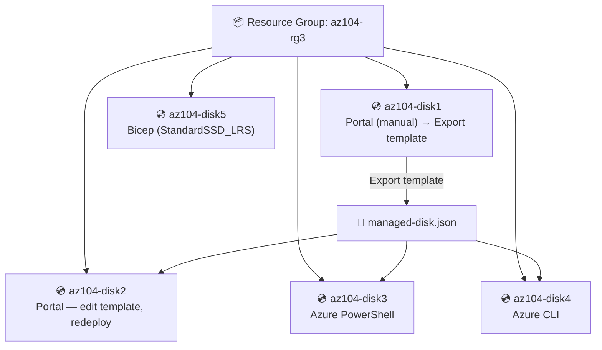

# 🏗️ Azure Infrastructure as Code — 5 Deployment Methods, One Template


A hands-on Infrastructure-as-Code project: deploy the same Azure resource **five separate times**, using **five different deployment methods** — Portal, edited-and-redeployed template, PowerShell, CLI, and Bicep — to prove one template can drive consistent, repeatable infrastructure regardless of the tool triggering it.

---

## 📌 The scenario

> A team wants to reduce administrative overhead, human error, and inconsistency in resource deployments — by moving from manual portal clicks to reusable, version-controllable Infrastructure as Code.

---

## 🏗️ Architecture



---

## 🧩 What was built & verified — 5 tasks

| # | Task | Method | Result |
|---|---|---|---|
| 1 | Create an ARM template | Created `az104-disk1` manually in the Portal, then used **Export template** to download the real `template.json` + `parameters.json` | ✅ Disk created; template captured |
| 2 | Edit & redeploy | Loaded the exported template into the Portal's built-in editor, renamed the parameter to `disk_name`, changed the value to `az104-disk2`, redeployed via **Custom Deployment** | ✅ `az104-disk2` created |
| 3 | Deploy with PowerShell | Uploaded the template to **Azure Cloud Shell**, edited the disk name to `az104-disk3`, ran `New-AzResourceGroupDeployment` | ✅ `az104-disk3` created |
| 4 | Deploy with the CLI | Same template, edited to `az104-disk4`, deployed with `az deployment group create` from Cloud Shell **Bash** | ✅ `az104-disk4` created |
| 5 | Deploy with Bicep | Uploaded the lab's `azuredeploydisk.bicep`, edited name/size/**SKU** (`StandardSSD_LRS`), deployed directly with the CLI | ✅ `az104-disk5` created — different SKU, proving genuine parameterization |

**Final verification** — `az disk list --resource-group az104-rg3 --output table`:
```
Name         Location   Sku              SizeGb   ProvisioningState
-----------  ---------  ---------------  -------  -------------------
az104-disk1  eastus     Standard_LRS     32       Succeeded
az104-disk2  eastus     Standard_LRS     32       Succeeded
az104-disk3  eastus     Standard_LRS     32       Succeeded
az104-disk4  eastus     Standard_LRS     32       Succeeded
az104-disk5  eastus     StandardSSD_LRS  32       Succeeded
```

---

## 📁 Repository Structure

```
azure-arm-bicep-deployment-lab/
├── README.md
├── .gitignore
├── templates/
│   ├── managed-disk.json               # The real exported/edited ARM template
│   ├── managed-disk.parameters.json
│   └── managed-disk.bicep               # The Bicep equivalent (Task 5)
├── scripts/
│   ├── 01-create-resource-group-and-disk1.sh
│   ├── deploy-with-powershell.ps1        # Task 3
│   ├── deploy-with-cli.sh                 # Task 4
│   ├── deploy-with-bicep.sh                # Task 5
│   └── cleanup.sh / .ps1
└── docs/
    ├── architecture.md                     # Design reasoning
    ├── deployment-methods-comparison.md      # When to use which method
    └── screenshots/                            # 28 real portal/CLI screenshots, in lab order
```

---

## 🚀 Try it yourself

### Prerequisites
- An Azure subscription
- [Azure CLI](https://learn.microsoft.com/cli/azure/install-azure-cli) (`az login`) and/or [Az PowerShell](https://learn.microsoft.com/powershell/azure/install-azure-powershell)

### Run the full sequence
```bash
cd scripts
chmod +x *.sh

./01-create-resource-group-and-disk1.sh   # Task 1 (CLI equivalent of the portal step)
./deploy-with-cli.sh                       # Task 4 method
pwsh ./deploy-with-powershell.ps1          # Task 3 method
./deploy-with-bicep.sh                      # Task 5 method
```

### Clean up
```bash
./cleanup.sh
```

---

## 📸 Lab Walkthrough (real screenshots)

| # | Step | Screenshot |
|---|---|---|
| 1 | Lab introduction & scenario | `01-lab-intro.png` |
| 2 | Architecture diagram & 5-task breakdown | `02-architecture-diagram-and-tasks.png` |
| 3 | Create managed disk form (Task 1) | `03-create-managed-disk-form.png` |
| 4 | Disks blade, empty | `04-storage-disks-blade-empty.png` |
| 5 | Disk creation review | `05-create-disk-review.png` |
| 6 | `az104-disk1` created | `06-disk1-created-overview.png` |
| 7 | Export template — ARM view | `07-export-template-arm-view.png` |
| 8 | Export template — Parameters view | `08-export-template-parameters-view.png` |
| 9 | Task 2 — blank template editor | `09-task2-edit-template-blank-editor.png` |
| 10 | Task 2 — loaded template.json, edits made | `10-task2-loaded-template-json.png` |
| 11 | Task 2 — custom deployment for disk2 | `11-task2-custom-deployment-disk2.png` |
| 12 | Task 2 — both disks now in the resource group | `12-task2-two-disks-in-rg.png` |
| 13 | Deployment history | `13-deployment-history.png` |
| 14 | Task 3 — uploading files to Cloud Shell | `14-task3-cloudshell-upload-files.png` |
| 15 | Task 3 — setting Az context | `15-task3-set-azcontext.png` |
| 16 | Task 3 — Get-AzContext result | `16-task3-get-azcontext-result.png` |
| 17 | Task 3 — `New-AzResourceGroupDeployment` for disk3 | `17-task3-new-azresourcegroupdeployment-disk3.png` |
| 18 | Task 3 — `Get-AzDisk` shows 3 disks | `18-task3-get-azdisk-three-disks.png` |
| 19 | Task 4 — switching to Bash | `19-task4-switch-to-bash.png` |
| 20 | Task 4 — `az deployment group create` for disk4 | `20-task4-az-deployment-group-create-disk4.png` |
| 21 | Task 4 — deployment succeeded (JSON output) | `21-task4-deployment-succeeded-json.png` |
| 22 | Task 5 — Bicep file uploaded & opened | `22-task5-bicep-file-uploaded.png` |
| 23 | Task 5 — deploy command | `23-task5-deploy-bicep-command.png` |
| 24 | Task 5 — Bicep compiling (with an expected warning) | `24-task5-bicep-compile-warning.png` |
| 25 | Task 5 — deployment succeeded | `25-task5-deployment-succeeded.png` |
| 26 | **All 5 disks**, final verification table | `26-final-disk-list-all-five.png` |
| 27 | Cleanup — `az group delete` prompt | `27-cleanup-group-delete-prompt.png` |
| 28 | Cleanup confirmed — resource group gone | `28-cleanup-confirmed-deleted.png` |

*(All in `docs/screenshots/` — GitHub renders them directly.)*

---

## 🧠 What this project demonstrates
- Core **Infrastructure as Code** principles: same template, deployed consistently across multiple tools
- **Exporting** a manually-created Azure resource into a reusable ARM template
- Editing and redeploying templates both through the **Portal UI** and via **scripting shells**
- Practical fluency in **Azure PowerShell** (`New-AzResourceGroupDeployment`), the **Azure CLI** (`az deployment group create`), and **Bicep**
- Understanding that **Bicep compiles to ARM JSON** — it's a syntax improvement, not a different deployment engine
- Parameterized templates that produce genuinely different infrastructure (SKU change) from the same source file
- Full lifecycle: build → export → edit → redeploy (x3 methods) → verify → tear down

---

## 📄 License
This project is for learning purposes and documents a personal Azure training lab.
